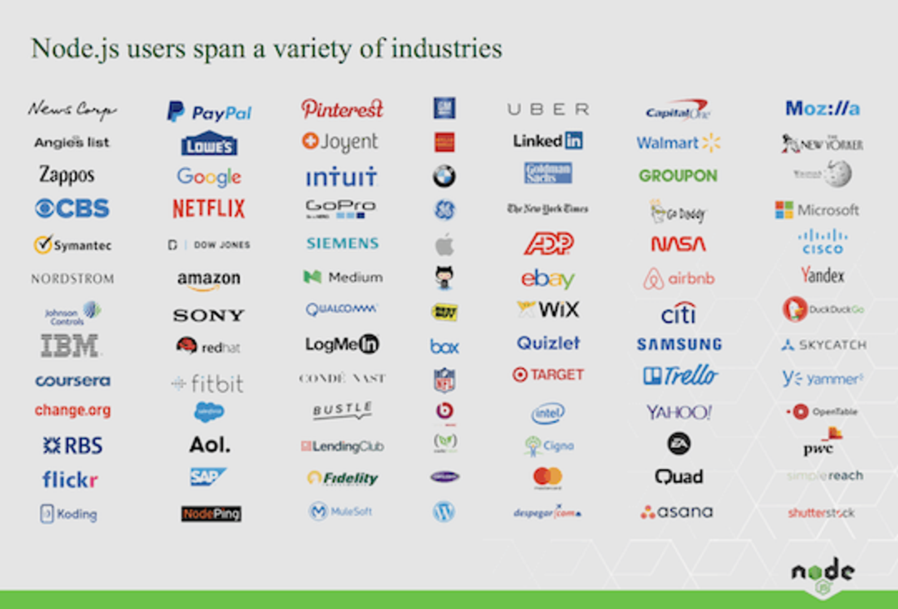
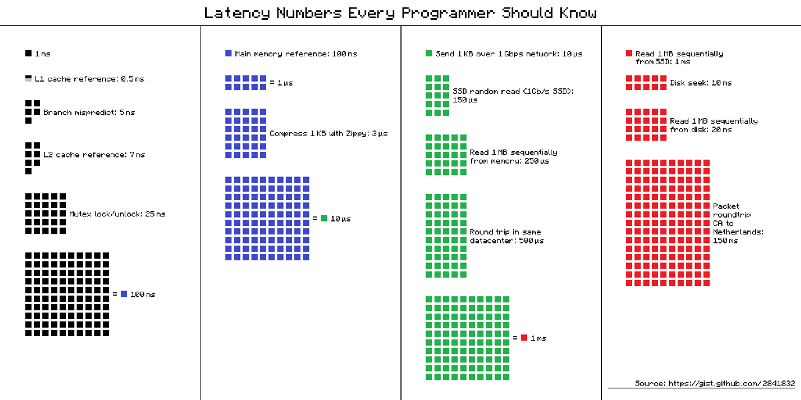

# 

## Why the enthusiasm for Node.js?

First and foremost, **performance** - businesses can handle more traffic with less hardware!

Secondly, developer **synergy** - developers can use JavaScript on both client & server; thus, becoming a full-stack dev is efficient, and companies can better utilize their developer resources across the front and back-ends.

The improvements in server performance and developer productivity result in **businesses saving money**.

Businesses saving money results in **wide adoption**:

tktk hunter -- this is from https://blog.risingstack.com/what-is-node-js-used-for-2017-survey/ . do we need/want to give credit or remake it?

Most importantly, the broad adoption of Node.js results in solid demand for Node developers!

## Why is Node.js so performant?

First, it's crucial to understand how time-consuming or expensive Input/Output operations are:

tktk hunter -- not sure where this is originally from, but another option is to remake if you think it adds value

Node's **Asynchronous / Event-driven** design enables **non-blocking** Input/Output. Thus, a typical Node server can support tens of thousands of concurrent connections! For more performance information, check the references at the end of this presentation.

> 📚 Asynchronous, event-driven design is a programming paradigm in which tasks or operations are executed concurrently and independently without blocking the execution of an application. This allows a system to continue with other tasks while waiting for the completion of time-consuming operations such as network requests.
